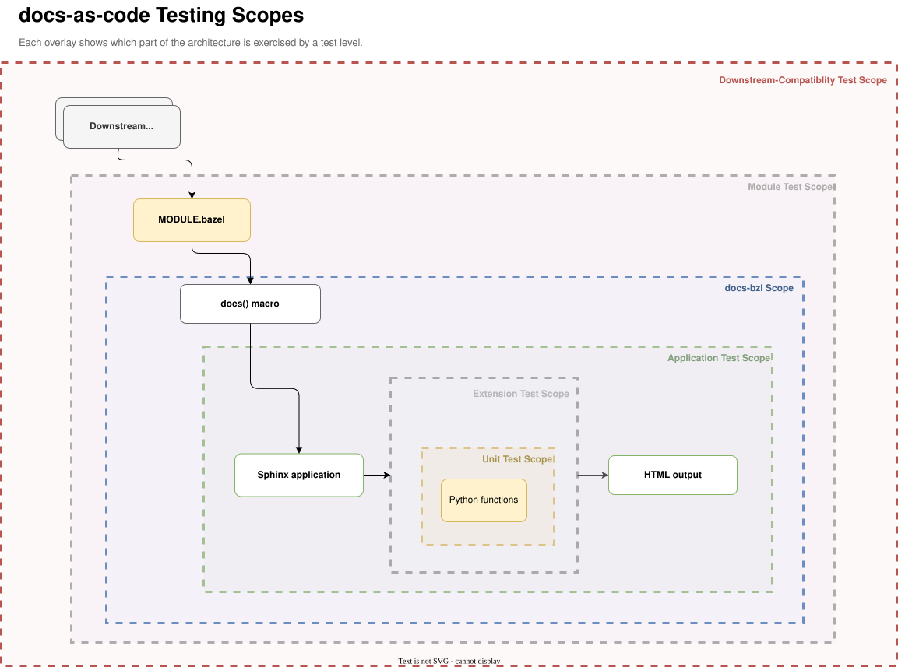

<!-- ----------------------------------------------------------------------------
  Copyright (c) 2026 Contributors to the Eclipse Foundation

  See the NOTICE file(s) distributed with this work for additional
  information regarding copyright ownership.

  This program and the accompanying materials are made available under the
  terms of the Apache License Version 2.0 which is available at
  https://www.apache.org/licenses/LICENSE-2.0

  SPDX-License-Identifier: Apache-2.0
----------------------------------------------------------------------------- -->

# Docs-As-Code Consumer Tests

# Testing



## end-to-end tests

*Also known as system, product, or black-box tests.*

This directory contains end-to-end tests at two scopes:

- `end_to_end`: controlled scenarios for the public `docs.bzl` API:
  `docs()`, `docs_bundle()`, composition, invalid configurations, and external
  Bzlmod bundles. The scenarios form a separate consumer module that depends on
  `score_docs_as_code`; plain pytest runs the same `bazel build` / `bazel run`
  commands a consumer uses. See [end_to_end/README.md](end_to_end/README.md)
  for what is covered and where to add a test.

- `downstream_compatibility`: *(formerly consumer tests)* Tests local changes and Git-based overrides against real consumer repositories. This provides broad, intentionally less-controlled coverage and helps detect breaking changes in the docs-as-code system before they affect downstream consumers.

`bazel test //...` covers internal unit tests. It intentionally does not run
the `end_to_end` suite; CI and local contributors run that
suite explicitly through pytest.

### Bazel test targets

You can query targets in this directory with:

```bash
bazel query 'kind(".*_test", //src/tests/...)'
```
